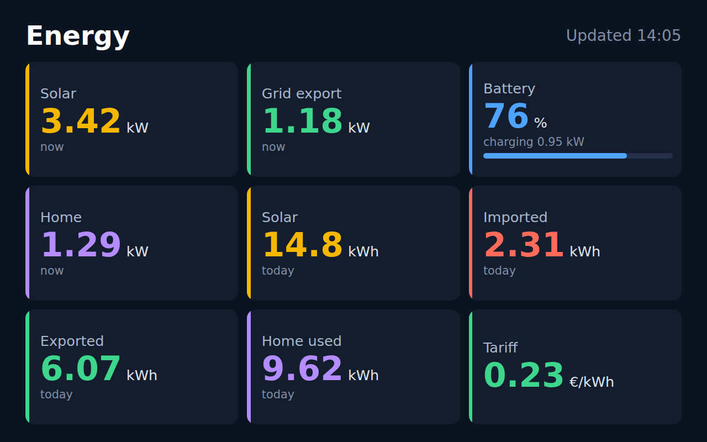
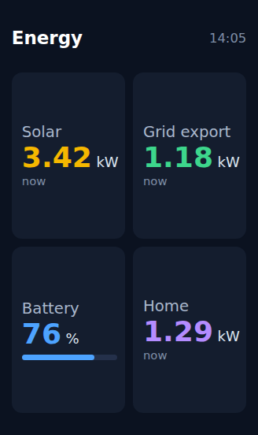
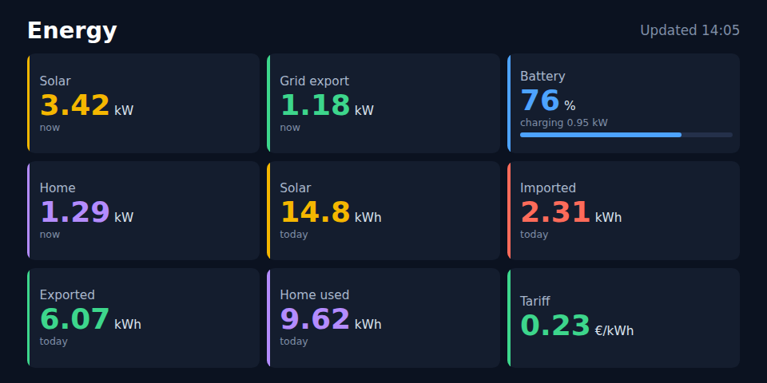
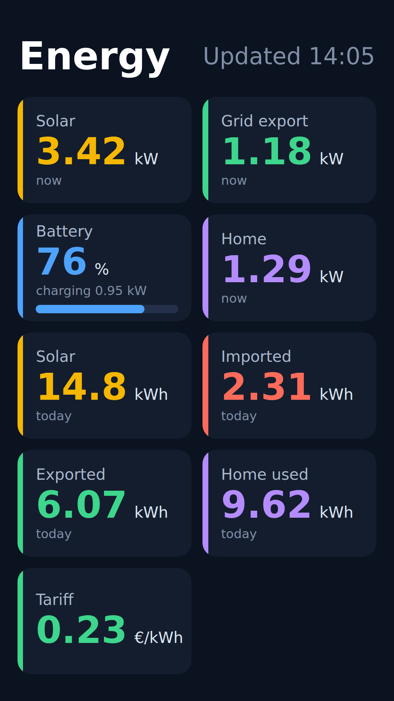
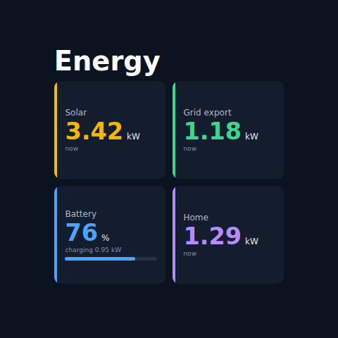
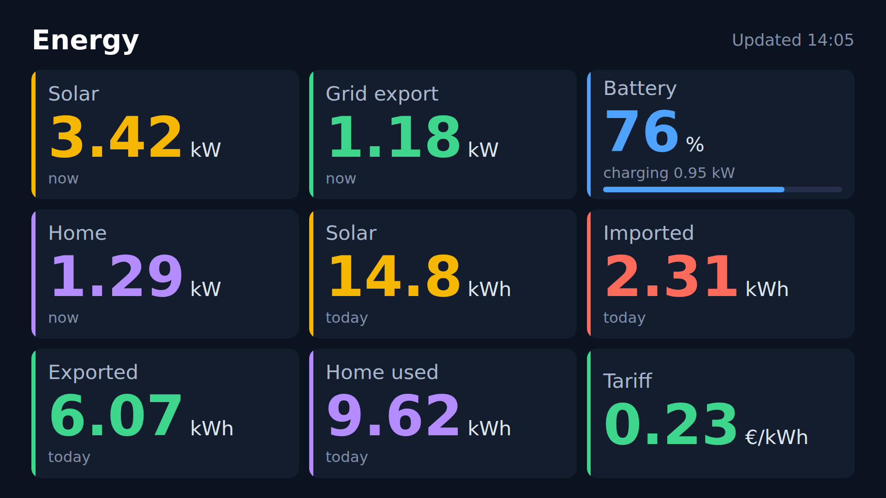

# Alexa Energy Display for Home Assistant

Show live energy data from your own Home Assistant on an Amazon Echo Show, without
flashing firmware, sideloading apps or keeping a browser open.

- **Home screen widget**: four tiles (for example solar, grid, battery, home) that
  Home Assistant keeps up to date in the background.
- **Full-screen view**: "Alexa, open energy display" shows up to twelve tiles and
  refreshes every minute while it is on screen.
- **Any data source**: reads your Energy dashboard configuration automatically
  (live power and today's kWh), and/or any other entities you pick (tariffs, EV charge,
  inverter mode, temperatures and so on).
- **Voice on screenless Echos**: the same skill reads the numbers out.
- **Voice and routines (optional second skill)**: Solar, Grid, Battery and Home Energy
  become read-only Alexa smart home devices, account-linked to Home Assistant, so you can
  ask "Alexa, what's the battery level?" and trigger routines on battery or grid changes.
  See [docs/INSTALL-VOICE.md](docs/INSTALL-VOICE.md).
- **Optional**: "Alexa, ask energy display to open the dashboard" opens any Home
  Assistant dashboard in the Echo's Silk browser.

| Full screen (Echo Show 8, 1280×800) | Widget |
| --- | --- |
|  |  |

| Echo Show 5 | Echo Show 15 portrait | Echo Spot | Fire TV |
| --- | --- | --- | --- |
|  |  |  |  |

The images are mock-ups drawn from the same layout rules as the APL documents, using
sample data. They are not device screenshots.

## How it works

```
             ┌───────────────────────── your Amazon developer account ─────────────────────────┐
 Echo Show ──┤ "open energy display" → Energy Display skill (Alexa-hosted Lambda, this repo)    │
   ▲         └──────────────────────────────┬──────────────────────────────────────────────────┘
   │                                        │ POST webhook: who am I? (pairs the Alexa account)
   │                                        ▼          ◄── reply: current snapshot (full screen)
   │                        Home Assistant + Alexa Energy Display integration (this repo)
   │                                        │ every minute, when values change
   └──── on-device data store ◄─────────────┘ Alexa Data Store REST API (widget)
```

You deploy a private copy of the skill to your own Amazon developer account. It is
never published, so only your Amazon account can use it. The Home Assistant integration
builds a small JSON snapshot of pre-formatted tiles. It serves that snapshot to the skill
through a secret webhook and pushes it to the widget through Amazon's
[Data Store API](https://developer.amazon.com/en-US/docs/alexa/alexa-presentation-language/data-store-rest-api-reference.html).
Details are in [docs/HOW-IT-WORKS.md](docs/HOW-IT-WORKS.md).

## Requirements

- Any Alexa device with a screen. The full-screen view adapts to the size, shape,
  orientation and APL version each device reports: Echo Show 5/8/10/15/21 (landscape
  and portrait), Echo Spot (round and 2024), Echo Hub, Fire TV, Fire tablets in Show
  mode and Alexa in the car. Devices back to APL 1.3 are supported.
  The widget needs a device with widget support, which Amazon doesn't fully list: Echo
  Show 8 (2nd gen or later), 10, 15 or 21. On the Show 8 it sits behind the home
  screen's widget shortcut.
- Home Assistant 2026.1 or newer, reachable from the internet over HTTPS: Home
  Assistant Cloud (Nabu Casa), or your own domain/reverse proxy. Only the one webhook
  is used. No long-lived access token leaves your Home Assistant.
- A free [Amazon developer account](https://developer.amazon.com/alexa/console/ask),
  signed in with **the same Amazon account as your Echo**.

## Install

1. **Home Assistant integration**: [docs/INSTALL-HOME-ASSISTANT.md](docs/INSTALL-HOME-ASSISTANT.md)
   (HACS custom repository, about 5 minutes).
2. **Alexa skill and widget**: run `tools/setup_skill.py` (ASK CLI, a few minutes, see
   [docs/INSTALL-SKILL.md](docs/INSTALL-SKILL.md#automatic-setup-recommended)), or follow
   the manual console steps in the same guide.
3. Optional voice skill: `tools/setup_smart_home.py`
   ([docs/INSTALL-VOICE.md](docs/INSTALL-VOICE.md)).
4. On your Echo, say **"Alexa, open energy display"** once. This pairs your Alexa
   account with Home Assistant, and the widget starts updating.

## Status and limits

- Tested in simulation, not yet on real hardware. The skill handlers run through the
  real Alexa SDK with simulated Echo Show requests. The integration is tested with
  Home Assistant's test harness, including real recorder statistics, the webhook and
  mocked Amazon endpoints. The APL documents pass Amazon's `apl-suggester`. Please
  report what works on your device.
- Amazon documents widgets as installable from the developer console's widget
  authoring tool for a skill in development, so you never publish anything. Amazon may
  change this.
- The full-screen view stays up while the skill session is open, which can be minutes
  to hours. Amazon decides when to end it. The widget has no such limit.
- Values are as fresh as the update interval (default 60 s) plus Amazon's delivery
  time.
- English locales are included (US, UK, AU, CA, IN). Other languages need an
  interaction model and widget metadata for that locale.

## Why not a fake camera feed or a browser?

Silk can show a dashboard, but it times out back to the home screen and needs a
keep-alive. A dashboard rendered as a camera stream needs a video pipeline and a camera
bridge, and still times out. Native APL plus the widget data store is the only
supported way for third parties to put live content on the Echo Show home screen.

## Development

```sh
uv venv -p 3.14 .venv && uv pip install -p .venv/bin/python -r requirements_test.txt
.venv/bin/python -m pytest -q                       # skill + integration + contract tests
npm install --no-save apl-suggester && node tools/validate-apl.js lambda/apl/*.json \
  skill-package/dataStorePackages/EnergyWidget/documents/document.json
.venv/bin/python tools/render_previews.py --chrome /path/to/chrome   # README/gallery images
```

Repository layout:

| Path | What |
| --- | --- |
| `skill-package/` | Skill manifest, interaction models, widget package (`dataStorePackages/EnergyWidget`), icons |
| `lambda/` | Skill code (Python, ask-sdk-core); `apl/fullscreen.json` is the full-screen document |
| `smart-home/` | Voice smart home skill: Lambda forwarder and manifest |
| `custom_components/alexa_energy_display/` | Home Assistant integration (HACS) |
| `tests/` | `skill/` handler tests, `integration/` HA tests, `test_contract.py` APL field checks |
| `tools/` | `setup_skill.py`, `setup_smart_home.py` (ASK CLI automation), APL validator, preview renderer |

MIT licensed. Not affiliated with Amazon or Home Assistant / Nabu Casa.
